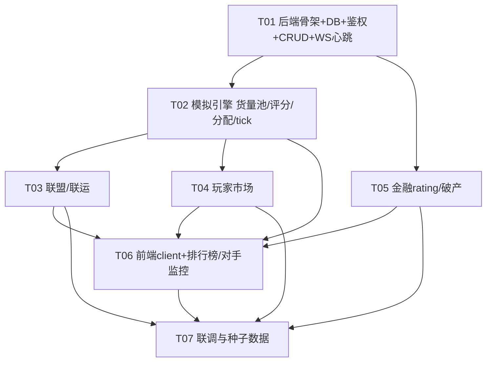

# 《物流大亨》多人化 · 系统设计文档（System Design）

> 文档作者：架构师 Bob
> 设计依据：team-lead 启动 prompt（AirlineSim 玩法映射 + 已锁死决策 + P0/P1/P2）
> 配套图：<a href="./class-diagram.mermaid">class-diagram.mermaid</a> · <a href="./sequence-diagram.mermaid">sequence-diagram.mermaid</a>
> 语言：中文

---

## Part A · 系统设计

### 1. 实现方案（Implementation Approach）

#### 1.1 核心难点与决策

| 难点 | 方案 |
| --- | --- |
| 多人共享同一世界、状态必须权威一致 | **服务端权威（server-authoritative）**：所有状态以服务端 `WorldManager` 内存态为唯一真相，DB 仅作持久化与审计；客户端只发意图、收快照/增量。 |
| 实时性 + 弱网重连 | **WebSocket 实时推送 + 心跳 + 重连**：服务端 tick 驱动模拟，每个 tick 广播 `delta`；客户端用 `reconnecting-websocket` 自动重连并请求 `world_snapshot` 补状态。 |
| 多公司争抢同一 OD 货量（AirlineSim 式共享需求市场） | **按 OD 的货量池（CargoPool）+ 评分分配模型**：每 tick 为每个有运力的 OD 计算需求 `D(OD)`，按各公司 `rating` 比例分配 `cargo_i = D(OD)·rating_i/Σrating`（详见 §3.5）。 |
| 时间流速可控、可暂停 | 世界级 `TickSeconds`（默认 10s = 1 游戏日），`Ticker` 按 `time.Ticker` 驱动；`Status=paused` 时停止推进。 |
| 复用单机版资产、但完全解耦 | `client/` 直接**复制** `game/src/game` 的类型与 `map.tsx`（vendored snapshot，不 import 父工程）；现有 `game/` 单机版**原样保留、不并入、不改动**。 |

#### 1.2 框架与库选型

**服务端（Go）**

| 库 | 版本 | 用途 |
| --- | --- | --- |
| Go | 1.22+ | 语言运行时 |
| gofiber/fiber/v2 | v2 | HTTP/REST 框架，路由、中间件 |
| golang-jwt/jwt/v5 | v5 | JWT 签发/校验（登录态） |
| golang.org/x/crypto/bcrypt | latest | 密码哈希 |
| gorm.io/gorm + gorm.io/driver/sqlite（modernc） | v1.25+ | ORM；用 `modernc.org/sqlite` 纯 Go 驱动，**免 cgo** |
| github.com/gorilla/websocket | v1.5 | WebSocket 升级与连接管理 |
| github.com/google/uuid | v1.6 | 实体 ID |

**客户端（React）**

| 库 | 版本 | 用途 |
| --- | --- | --- |
| Vite + React + TypeScript | 18/5 | 构建与 UI |
| zustand | v4 | 状态管理（session / world / companies / myCompany / map） |
| reconnecting-websocket | v4 | WS 自动重连 |
| maplibre-gl | v4 | 复用单机版 MapLibre 地图组件 |
| lucide-react | latest | 图标 |

#### 1.3 架构分层（服务端）

```
┌──────────────────────── 客户端 client/ (React 瘦客户端) ────────────────┐
│  components/*  ·  state(zustand)  ·  api(REST+WS)                        │
└───────────────┬───────────────────────────────┬────────────────────────┘
           REST │ (fetch)                   WS │ (reconnecting-websocket)
                ▼                                ▼
┌──────────────────────────── 服务端 server/ (Go Fiber) ────────────────────────────┐
│ handler/   REST 路由 + WS upgrade（鉴权中间件）                                      │
│   │                                                                                │
│   ├─ auth/      JWT 签发/解析、bcrypt 校验                                          │
│   ├─ company/   建点/购车租赁/开线路/派单/借贷还款（业务规则）                         │
│   ├─ market/    玩家市场挂单/撤单/撮合                                              │
│   ├─ sim/       货量池生成 + 评分 + 分配 + tick 结算（纯函数核心）                    │
│   ├─ world/     WorldManager：内存权威态 + 订阅 + 广播                                │
│   ├─ ws/        Hub：连接管理、心跳、delta 广播                                      │
│   ├─ repo/      GORM 仓储（CRUD）                                                   │
│   └─ model/     实体与枚举/常量                                                      │
└───────────────────────────────────┬──────────────────────────────────────────────┘
                                     ▼
                            SQLite (modernc, 无 cgo)
```

设计原则与单机版一致：**sim/ 与 company/ 内部为纯函数/可单测规则**，repo 只负责持久化，world 负责编排与广播，handler 只做协议转换。

---

### 2. 文件清单（File List）

#### 服务端 `server/`

```
server/
├── cmd/server/main.go                 # 启动：配置→DB迁移→repo→auth→world→ws→handler→Ticker→Listen
├── go.mod
├── config.yaml                        # TickSeconds、货量常量、权重、破产阈值等（可被环境变量覆盖）
├── internal/
│   ├── model/
│   │   ├── models.go                  # User/World/Company/Node/Vehicle/Lane/CargoPool/Order
│   │   ├── models2.go                 # Alliance/AllianceMember/MarketListing/Loan/LedgerEvent/Rating
│   │   ├── enums.go                   # NodeTier/TransportMode/OrderKind/OrderStatus/ListingType/MemberRole/VehicleStatus
│   │   └── constants.go               # 货量/评分/金融常量（见 §8）
│   ├── repo/
│   │   ├── db.go                      # GORM 初始化 + AutoMigrate
│   │   ├── user_repo.go
│   │   ├── world_repo.go
│   │   ├── company_repo.go
│   │   ├── market_repo.go
│   │   └── sim_repo.go                # CargoPool/Order/Rating/LedgerEvent 读写
│   ├── auth/
│   │   ├── jwt.go                      # 签发/解析
│   │   ├── password.go                 # bcrypt
│   │   └── middleware.go               # Fiber JWT 中间件 + 解析 Company
│   ├── world/
│   │   ├── manager.go                  # WorldManager：世界注册、内存态、订阅
│   │   └── world_state.go             # 内存权威态结构 + 快照/增量构造
│   ├── company/
│   │   ├── service.go                  # 建点/购车租赁/开线路/派单/借贷还款
│   │   └── validate.go                 # 模式合法/沿海/仓位/载重校验
│   ├── market/
│   │   └── service.go                  # 挂单/撤单/撮合
│   ├── sim/
│   │   ├── engine.go                   # Tick() 主循环 + 结算顺序（§3.6）
│   │   ├── cargo.go                    # CargoPool 生成与窗口截断
│   │   ├── rating.go                   # rating_i(OD) 计算（§3.5）
│   │   └── allocate.go                 # 按 rating 比例分配 → Order
│   ├── ws/
│   │   ├── hub.go                      # 连接注册/注销、广播
│   │   ├── conn.go                     # 单连接读写、心跳、消息解析
│   │   └── messages.go                 # WS 消息 schema（§8.1）
│   └── handler/
│       ├── auth_handler.go            # register/login/me
│       ├── world_handler.go           # 列表/创建/加入/state
│       ├── company_handler.go         # 公司 CRUD + 建点/车辆/线路/派单/金融
│       ├── alliance_handler.go         # 联盟创建/加入/退出
│       ├── market_handler.go          # 市场列表/挂单/撤单/成交
│       ├── leaderboard_handler.go     # 排行榜/对手监控
│       └── ws_handler.go              # GET /ws 升级
└── seed/
    └── seed.go                        # 40 城市 + 默认世界 + 种子公司
```

#### 客户端 `client/`

```
client/
├── index.html
├── package.json
├── vite.config.ts
├── tsconfig.json
├── tailwind.config.js
├── src/
│   ├── main.tsx
│   ├── App.tsx
│   ├── api/
│   │   ├── rest.ts                    # fetch 封装 + 端点常量（§8.2）
│   │   ├── ws.ts                      # reconnecting-websocket 封装
│   │   └── types.ts                   # 与 server/model 对齐的 TS 类型（复制 game/src/game 类型）
│   ├── state/
│   │   ├── session.ts                 # 登录态/JWT
│   │   ├── world.ts                   # worldState 快照/增量合并
│   │   ├── myCompany.ts               # 我的公司（建点/车辆/线路/金融）
│   │   └── opponents.ts               # 排行榜/对手监控
│   ├── game/                          # ★ 从 game/src/game 复制的类型与常量（vendored，不 import 父工程）
│   │   ├── cities.ts
│   │   └── types.ts
│   ├── components/
│   │   ├── Login.tsx
│   │   ├── Lobby.tsx                  # 世界列表/创建/加入
│   │   ├── HUD.tsx                    # 现金/天数/声誉/资产/负债/排名
│   │   ├── GameMap.tsx                # 复用 game 的 MapLibre 组件 + 对手运力叠加
│   │   ├── BuildPanel.tsx             # 建/升物流点
│   │   ├── FleetPanel.tsx             # 购车/租赁/退租
│   │   ├── LanePanel.tsx              # 开线路（报价/时效/联运）
│   │   ├── MarketPanel.tsx            # 玩家市场挂单/成交
│   │   ├── FinancePanel.tsx           # 借贷/还款
│   │   ├── AlliancePanel.tsx          # 联盟/联运
│   │   ├── Leaderboard.tsx            # 排行榜
│   │   └── OpponentMonitor.tsx        # 对手监控
│   └── lib/
│       └── utils.ts                   # cn 等
```

> 说明：`client/src/game` 是 `game/src/game` 的**有意复制**（vendored snapshot），顶部加声明「请勿 import 父工程，升级直接改本文件」，与单机版解耦策略一致。

---

### 3. 数据结构与接口（Data Structures & Interfaces）

完整 classDiagram 见 `class-diagram.mermaid`，核心实体与关系如下（字段含类型注解，关系已用箭头标注）：

- **User 1—\* Company**（owns）
- **World 1—\* Company / CargoPool / Alliance**（contains / generates）
- **Company 1—\* Node / Vehicle / Lane / Order / Loan / LedgerEvent / Rating**（聚合根）
- **Company 0..1—0..1 Alliance**（经 `AllianceMember` 多对多）
- **CargoPool \*—1 World**；**Order \*—1 Company**，可选关联 `Vehicle`/`Lane`
- **MarketListing \*—1 World / ListerCompany**，可选 `BuyerCompany`

#### 3.1 关键实体字段摘要

| 实体 | 关键字段 |
| --- | --- |
| `World` | `TickSeconds`(默认10) `CurrentDay` `Status`(setup/running/paused) `SeedConfig` |
| `Company` | `Cash` `Reputation` `Debt` `NetWorth` `AllianceID?` |
| `Node` | `CityID` `Tier`(station/local/city/hub) `Capacity` `HandlingDays` |
| `Vehicle` | `TypeID` `Mode` `CapacityTons` `Owned` `LeaseDaily` `LeaseUntilDay?` `BusyUntilDay?` |
| `Lane` | `FromCityID` `ToCityID` `Mode` `CapacityTonsPerDay` `PricePerTon` `TransitDays` `Interline` `Active` |
| `CargoPool` | `FromCityID` `ToCityID` `TotalTons`(=D) `WindowDays`(N) `GeneratedDay` `ExpiresDay` |
| `Order` | `Kind`(contract/spot) `Tons` `PricePerTon` `Reward` `Status` `VehicleID?` `LaneID?` |
| `Alliance` / `AllianceMember` | `InterlineEnabled` / `Role`(leader/member) |
| `MarketListing` | `Type`(capacity_sell/cargo_buy/cargo_sell/lane_lease) `Tons` `PricePerTon` `Status` `BuyerCompanyID?` |
| `Loan` | `Principal` `RatePerDay` `TakenDay` `DueDay?` `Repaid` |
| `LedgerEvent` | `Day` `Type` `Amount`(有符号) `Note` |
| `Rating` | `FromCityID` `ToCityID` `PriceScore` `TransitScore` `CoverageScore` `InterlineScore` `Composite` |

#### 3.2 接口（核心服务方法签名）

```go
// auth
func IssueToken(userID uuid.UUID) (string, error)
func ParseToken(token string) (uuid.UUID, error)
func HashPassword(pw string) (string, error)
func VerifyPassword(hash, pw string) bool

// world
func (m *WorldManager) Start(w *World)
func (m *WorldManager) Subscribe(companyID, worldID uuid.UUID, c *ws.Conn)
func (m *WorldManager) Snapshot(worldID uuid.UUID) *WorldState
func (m *WorldManager) BroadcastDelta(worldID uuid.UUID, d *Delta)

// company
func CreateNode(cid, worldID uuid.UUID, cityID string, tier NodeTier) error
func BuyOrLeaseVehicle(cid uuid.UUID, typeID string, lease bool) error
func CreateLane(cid, worldID uuid.UUID, in LaneInput) error
func DispatchOrder(cid, orderID, vehicleID uuid.UUID) error
func Borrow(cid uuid.UUID, amount int64) error
func Repay(cid uuid.UUID, amount int64) error

// market
func ListListing(in MarketInput) error
func CancelListing(listingID, cid uuid.UUID) error
func FillListing(listingID, buyerID uuid.UUID, tons float64) error

// sim
func Tick(worldID uuid.UUID)                 // 见 §3.6 结算顺序
func GenerateCargo(w *World)                 // 生成/截断 CargoPool
func Rate(company *Company, od OD, ref Ref) float64
func Allocate(w *World)                      // 按 rating 比例生成 Order
```

---

### 3.5 共享货量评分模型（核心多人机制）

每个 tick，对所有「至少 1 家公司开了 Lane」的 OD 对执行：

```
// 评分（四个维度归一化后加权，权重和=1）
func Rate(c *Company, od OD, ref Ref) float64 {
    priceScore    := clamp(ref.PriceRef / c.lane.PricePerTon, 0.2, 2.0)   // 越便宜越高
    transitScore  := clamp(ref.TransitRef / c.lane.TransitDays, 0.2, 2.0) // 越快越高
    coverageScore := min(1.0, float64(c.lane.CapacityTonsPerDay) / od.Demand) // 运力覆盖需求
    interlineScore:= allianceBonus(c, od)   // 基础 1.0；若公司在联盟且 lane.Interline=true 则 >1（可达更多目的地）
    return W.price*priceScore + W.transit*transitScore + W.coverage*coverageScore + W.interline*interlineScore
}

// 分配（按 rating 比例切分需求 D(OD)）
func Allocate(w *World) {
    for od := range activeODs(w) {            // 仅对有 Lane 的 OD
        sum := 0.0
        for _, c := range companiesWithLane(w, od) {
            c.r = Rate(c, od, w.ref); sum += c.r
        }
        for _, c := range companiesWithLane(w, od) {
            tons := od.Demand * c.r / sum     // cargo_i
            createOrder(c, od, tons, c.lane.PricePerTon, c.lane.Mode) // kind=contract
        }
    }
}
```

- `D(OD)` = 当 tick `CargoPool.TotalTons`，由 `GenerateCargo` 按城市重要度与随机波动生成。
- **N 天窗口截断**：`CargoPool.ExpiresDay = GeneratedDay + WindowDays`；tick 开始时先丢弃 `CurrentDay > ExpiresDay` 的池（需求「蒸发」，不结转），保证市场有前瞻窗口、避免无限堆积。
- `ref`（PriceRef/TransitRef）为按 OD 距离估算的参考基准（如 `TransitRef = haversine/speed + handling`），用于跨公司归一化。
- `allianceBonus`：同一联盟内成员互相视为可达（联运），覆盖率与可达 OD 增多 → 评分提升，激励组联盟。

#### 3.6 Tick 结算顺序（advanceDay / Tick）

```
Tick(worldID):
  1. 截断过期 CargoPool(day>ExpiresDay)；GenerateCargo → 新 D(OD)（WindowDays 窗口）
  2. 对每个有 Lane 的 OD：计算 rating_i → Allocate → 生成 Order(kind=contract, status=pending)
  3. 到达结算：在途且当日达的 Order → Cash += Reward - FuelCost；Reputation +1；释放 Vehicle
  4. 状态迁移：in-transit→delivered；accepted 超 DeadlineDay → expired（Reputation -3）
  5. 释放车辆：BusyUntilDay ≤ day → 置空闲
  6. 租赁扣费：每租赁车扣 LeaseDaily；LeaseUntilDay ≤ day 自动退租
  7. 贷款计息：Debt>0 → Cash -= round(Debt * LOAN_DAILY_RATE)
  8. 玩家市场撮合：对 open MarketListing 执行 tick 级匹配（或 REST 即时成交，见 §8.4）
  9. 重算净资产 NetWorth；写 Rating 快照；刷新排行榜
 10. 破产检查：NetWorth < BANKRUPTCY_FLOOR → 标记公司 bankrupt，停止其模拟并通知
 11. world.CurrentDay++；构造 Delta（companies/newOrders/market/events）→ BroadcastDelta
```

---

### 4. 程序调用流程（Program Call Flow）

三类关键流程的 Mermaid 见 `sequence-diagram.mermaid`：

1. **登录 → 加入世界 → WS 建连 → worldState 快照**（场景①）
2. **服务端 tick 循环**（场景②）
3. **REST 动作（建点/开线路/派单/借贷）→ handler → service → repo → notify → 广播**（场景③）

---

### 5. 待明确事项（Anything UNCLEAR）

下列数值需用户最终拍板；已给出**推荐默认值**（写入 `server/config.yaml`，可被环境变量覆盖）：

| 项 | 推荐默认 | 说明 |
| --- | --- | --- |
| `TickSeconds` | **10**（1 游戏日/10 秒） | 世界默认时间流速；过快易乱、过慢无感 |
| `CARGO_BASE` D(OD) | **40 吨/日**（× 城市重要度系数 一线1.0/省会0.8/其他0.6 × 波动 0.6~1.4） | 单 OD 基准日需求 |
| `WINDOW_DAYS` N | **7** | 货量前瞻窗口，过期蒸发 |
| 评分权重 W | **price 0.35 / transit 0.30 / coverage 0.20 / interline 0.15** | 权重和=1 |
| `LOAN_DAILY_RATE` | **0.002**（0.2%/日≈月6%） | 借款日息 |
| `LEASE_DAILY_RATE` | **0.02**（车价×2%） | 租赁日租 |
| `BANKRUPTCY_FLOOR` | **netWorth < -1,000,000** | 资不抵债且跌破地板 → 破产出局 |
| 公司初始 | **Cash 1,000,000 / Reputation 50 / Debt 0** | 沿用单机版 |
| 世界规模 | **40 城市（复用 cities.ts）** | 全部真实坐标 |

假设（assumptions）：
- 单机版 `game/` 不改动，客户端仅复制其类型/地图组件。
- `Order.kind=spot` 在多人版中保留为「世界随机散单」（不参与按 rating 分配，作为额外小单），主需求走 `contract`（按 rating 分配）。
- 玩家市场撮合以 REST 即时成交为主，tick 仅做到期清理；如需连续撮合可后续扩展。
- 地图底图与单机版一致（MapLibre + Carto WGS-84），零坐标偏移。

---

## Part B · 任务拆解

### 6. 依赖包（Required Packages）

**服务端（Go module）**
```
- github.com/gofiber/fiber/v2        # REST/HTTP 框架
- github.com/golang-jwt/jwt/v5        # JWT
- golang.org/x/crypto/bcrypt          # 密码哈希
- gorm.io/gorm                        # ORM
- gorm.io/driver/sqlite               # SQLite 驱动（modernc，无 cgo）
- github.com/gorilla/websocket        # WebSocket
- github.com/google/uuid              # 实体 ID
- github.com/stretchr/testify         # 单测（sim/company 规则）
```

**客户端（npm）**
```
- react@^18.2.0 / react-dom@^18.2.0   # UI
- vite@^5 / typescript@^5             # 构建
- zustand@^4.5                        # 状态
- reconnecting-websocket@^4.4         # WS 重连
- maplibre-gl@^4                      # 地图（复用单机版组件）
- lucide-react@^0.4xx                 # 图标
- tailwindcss@^3                      # 样式
```

---

### 7. 有序任务列表（按实现顺序，标依赖，≤8 阶段）

> 注：stage 间依赖尽量扁平；T02 之后 T03/T04 可并行；T06 在所有后端 API 稳定后开始。

- **T01 · 后端骨架 + DB + 鉴权 + World/Company CRUD + WS 心跳**
  - Source: `cmd/server/main.go`, `internal/model/*`, `internal/repo/*`, `internal/auth/*`, `internal/world/manager.go`, `internal/ws/hub.go`, `internal/ws/conn.go`, `internal/handler/auth_handler.go`, `internal/handler/world_handler.go`, `internal/handler/ws_handler.go`
  - Depends: 无
  - Priority: P0

- **T02 · 模拟引擎（货量池 + 评分 + 分配 + tick 主循环）**
  - Source: `internal/sim/engine.go`, `internal/sim/cargo.go`, `internal/sim/rating.go`, `internal/sim/allocate.go`, `internal/world/world_state.go`, `internal/repo/sim_repo.go`
  - Depends: T01
  - Priority: P0

- **T03 · 联盟 / 联运**
  - Source: `internal/model/models2.go`(Alliance/AllianceMember), `internal/handler/alliance_handler.go`, `internal/sim/rating.go`(allianceBonus), `internal/repo/*`
  - Depends: T02
  - Priority: P1

- **T04 · 玩家市场（挂单 / 撤单 / 撮合）**
  - Source: `internal/market/service.go`, `internal/handler/market_handler.go`, `internal/model/models2.go`(MarketListing)
  - Depends: T02
  - Priority: P1

- **T05 · 金融 rating / 破产**
  - Source: `internal/company/service.go`(Borrow/Repay/NetWorth), `internal/company/validate.go`, `internal/handler/company_handler.go`(finance), `internal/sim/engine.go`(利息/破产检查)
  - Depends: T01（Company/Loan/LedgerEvent 实体）
  - Priority: P1

- **T06 · 前端 client 适配 + 排行榜 / 对手监控**
  - Source: `client/src/api/*`, `client/src/state/*`, `client/src/components/*`(Login/Lobby/HUD/GameMap/BuildPanel/FleetPanel/LanePanel/FinancePanel/Leaderboard/OpponentMonitor), `client/src/game/*`
  - Depends: T02, T03, T04, T05（依赖稳定 API 与 WS schema）
  - Priority: P0

- **T07 · 联调与种子数据**
  - Source: `server/seed/seed.go`, `config.yaml`, `client/` 联调脚本, 端到端冒烟
  - Depends: T01–T06
  - Priority: P0

---

### 8. 共享约定（Shared Knowledge / Cross-cutting）

#### 8.1 WS 消息 Schema（`internal/ws/messages.go`，客户端 `api/ws.ts` 对齐）

```ts
// Client -> Server
{ type: "auth", token: string }            // 也可放 ?token= 查询参数
{ type: "join_world", worldId: string }
{ type: "ping" }                            // 心跳

// Server -> Client
{ type: "welcome", you: { companyId }, world: { id, name, day, status } }
{ type: "world_snapshot",
  day: number,
  companies: { id, name, cash, reputation, netWorth, rank }[],
  cargoPools: { from, to, totalTons, expiresDay }[],
  market: MarketListing[] }
{ type: "delta",
  day: number,
  companies: { id, cash, reputation, netWorth, rank }[],
  newOrders: Order[],
  lanes: Lane[],
  market: MarketListing[],
  events: LedgerEvent[] }
{ type: "pong" }
{ type: "error", code: number, msg: string }
```
- 所有时间戳/金额以服务端 `World.CurrentDay` 与「元（int64）」为单位；客户端仅渲染。
- 心跳：服务端 30s 无 `ping` 则断连；客户端 `reconnecting-websocket` 自动重连后请求 `world_snapshot` 补状态。

#### 8.2 REST 端点清单（`internal/handler/*`，客户端 `api/rest.ts` 对齐）

```
POST /api/auth/register           {username,password,email?} -> {token}
POST /api/auth/login              {username,password}        -> {token}
GET  /api/auth/me                 (Bearer)                   -> User

GET  /api/worlds                  (Bearer)                   -> World[]
POST /api/worlds                  (Bearer){name,tickSeconds?}-> World
POST /api/worlds/:id/join         (Bearer)                   -> {companyId}
GET  /api/worlds/:id/state        (Bearer)                   -> WorldState(snapshot)

GET  /api/companies/:id           (Bearer)                   -> Company(detail)
POST /api/companies/:id/nodes     (Bearer){cityId,tier}      -> Node
POST /api/companies/:id/vehicles  (Bearer){typeId,lease}     -> Vehicle
POST /api/companies/:id/lanes     (Bearer){from,to,mode,capacity,price,transitDays,interline} -> Lane
POST /api/companies/:id/orders/:orderId/dispatch (Bearer){vehicleId} -> Order
POST /api/companies/:id/finance/borrow (Bearer){amount}      -> {debt}
POST /api/companies/:id/finance/repay  (Bearer){amount}      -> {debt}

POST /api/worlds/:id/alliances    (Bearer){name}             -> Alliance
POST /api/alliances/:id/join      (Bearer){companyId}        -> AllianceMember
POST /api/alliances/:id/leave     (Bearer){companyId}        -> ok

GET  /api/worlds/:id/market       (Bearer)                   -> MarketListing[]
POST /api/market                  (Bearer){type,from,to,tons,price,mode} -> MarketListing
POST /api/market/:id/cancel       (Bearer){companyId}        -> ok
POST /api/market/:id/fill         (Bearer){companyId,tons?}  -> ok

GET  /api/worlds/:id/leaderboard  (Bearer)                   -> Company[](ranked)
GET  /api/companies/:id/opponents (Bearer)                   -> Company[](对手快照)

GET  /ws?token=...&worldId=...     (HTTP upgrade)            -> WS stream
```
- 统一响应包：`{ code:0, data:..., message:"" }`；错误 `code≠0` + `message`。
- 所有写操作需 `Bearer` + 公司归属校验（不能改他人公司）。

#### 8.3 DB Schema（GORM AutoMigrate；表名小写复数）

| 表 | 关键列 / 索引 |
| --- | --- |
| users | id(PK,uuid) username(uniq) password_hash email created_at |
| worlds | id(PK) name tick_seconds status current_day seed_config created_at |
| companies | id(PK) world_id(FK) owner_id(FK) name cash reputation debt net_worth alliance_id(FK?) created_at；idx(world_id) |
| nodes | id company_id(FK) world_id city_id tier capacity handling_days built_day lat lng |
| vehicles | id company_id(FK) type_id mode capacity_tons speed_kmh owned lease_daily lease_until_day busy_until_day status |
| lanes | id company_id(FK) world_id from_city_id to_city_id mode capacity_tons_per_day price_per_ton transit_days interline active created_day；idx(world_id,from,to) |
| cargo_pools | id world_id(FK) from_city_id to_city_id total_tons window_days generated_day expires_day；idx(world_id,from,to) |
| orders | id world_id(FK) company_id(FK) kind from_city_id to_city_id tons price_per_ton reward mode accepted_day deadline_day status vehicle_id(FK?) lane_id(FK?) |
| alliances | id world_id(FK) name interline_enabled created_day |
| alliance_members | id alliance_id(FK) company_id(FK) joined_day role |
| market_listings | id world_id(FK) lister_company_id(FK) type from_city_id to_city_id tons price_per_ton mode status created_day filled_day buyer_company_id(FK?) |
| loans | id company_id(FK) principal rate_per_day taken_day due_day repaid |
| ledger_events | id company_id(FK) world_id(FK) day type amount note |
| ratings | id company_id(FK) world_id(FK) from_city_id to_city_id price_score transit_score coverage_score interline_score composite computed_day |

#### 8.4 货量常量与公式集中地（`internal/model/constants.go`）

```go
const (
    DefaultTickSeconds   = 10
    CargoBaseTons        = 40.0
    WindowDays           = 7
    LoanDailyRate        = 0.002
    LeaseDailyRate       = 0.02
    BankruptcyFloor      = -1_000_000
    InitCash             = 1_000_000
    InitReputation       = 50
)
var RatingWeights = struct{ Price, Transit, Coverage, Interline float64 }{0.35, 0.30, 0.20, 0.15}
// CityTierMult: 一线1.0 / 省会0.8 / 其他0.6（复用单机版 cities.ts 的 tier）
```
- 玩家市场默认 REST 即时成交（挂单即进入 open 列表，对手 `fill` 即时结算）；tick 仅清理过期/已成交单。
- 所有金额单位「元」，用 `int64`；避免浮点误差。

---

### 9. 任务依赖图（Task Dependency Graph）



---

## 设计要点小结

- **服务端权威 + WebSocket 增量广播**，tick（默认 10s/日）驱动全部模拟，客户端瘦、只渲染。
- **AirlineSim 式共享需求市场**：按 OD 的 `CargoPool` + `rating_i` 加权（价格/时效/覆盖/联运）按比例分配，组联盟可吃联运加成。
- **后端 Go Fiber + GORM(modernc sqlite，免 cgo) + gorilla/websocket**；**前端 React+Vite+zustand+reconnecting-websocket**，复制 `game/` 类型与地图组件，**单机版 `game/` 原样保留不动**。
- 任务拆为 **7 个阶段（≤8）**，T01→T02 串行，T03/T04/T05 并行，T06 汇聚，T07 收口。
- 所有待拍板数值已给推荐默认并集中于 `config.yaml` / `constants.go`，便于后续手感微调。
